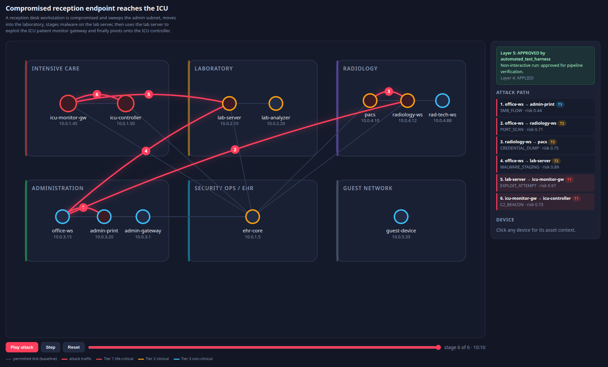
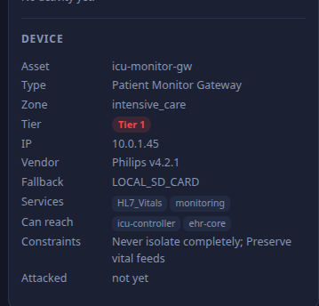
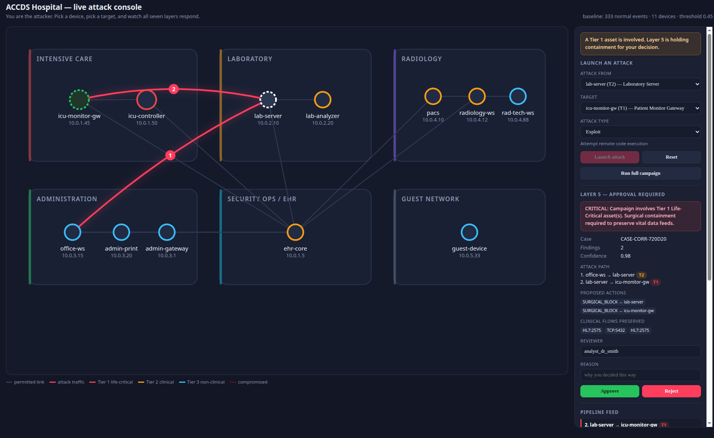

# ACCDS — Autonomous Clinical Cybersecurity Defense System

A layered defence system for hospital networks, developed against a digital twin.
It detects attacks, correlates them into campaigns, and chooses a response sized to
the **clinical consequence** of the device under threat — pausing for human approval
when patient safety is at stake.

```
office-ws → admin-print → radiology-ws → pacs → lab-server → icu-monitor-gw → icu-controller
   T3           T3            T2          T2       T2           TIER 1           TIER 1
                                                                 └── human approval required
```



*A six-stage campaign replayed across the twin. Grey lines are permitted network links;
red arcs are attack traffic, numbered in order. The attacker starts at a reception desk
workstation in Administration and arrives, six hops later, at two Tier&nbsp;1 life-critical
devices in Intensive Care — each hop launched from the machine taken in the one before.*

---

## The problem

In most environments the response to a compromised machine is obvious: isolate it.

In a hospital that response can be the greater harm. The same malware signature on an
office laptop and on the gateway streaming a patient's vital signs to the nurses'
station calls for two completely different actions. Isolating the laptop costs an
afternoon. Isolating the gateway leaves an intensive-care ward blind.

Clinical networks are full of devices that cannot be patched mid-procedure, cannot be
rebooted on demand, and cannot be taken offline. Conventional security tooling has no
model of any of that — it sees "infected host" and quarantines it.

ACCDS asks a harder question:

> What is the least disruptive effective response to this threat, given what this
> specific device does for patient care — and when must a human decide instead?

Success is not "the attack was blocked." Success is that the system can explain what
it observed, state what was at risk, select the gentlest effective control, obtain
human authorisation where the stakes demand it, verify the result, and preserve a
record that cannot be quietly altered.

---

## Core concept: clinical tiers

Every asset carries a tier that governs what the system may do to it.

| Tier | Example | Default posture |
|---|---|---|
| **1** | Patient monitor gateway, ICU controller | Surgical blocking only; **human approval mandatory** |
| **2** | Laboratory server, PACS, radiology workstation | Narrow containment; approval depends on confidence |
| **3** | Office endpoint, printer, guest device | Rapid isolation permitted automatically |

Containment preserves the clinical flows each device actually depends on — HL7 vitals
on an ICU gateway, DICOM imaging on a PACS server — so a block stops the attack
without taking a clinical service offline.



*What a tier means in practice. The ICU patient monitor gateway falls back to a local
SD card if isolated, speaks HL7 vitals, and carries the constraint "Never isolate
completely; Preserve vital feeds". That constraint is the reason the system will not
act on this device alone.*

---

## Quick start

Requires Python 3.12 or newer.

```bash
python3 -m venv agentic_venv
agentic_venv/bin/pip install -r requirements.txt

# Full seven-layer simulation
PYTHONPATH=. agentic_venv/bin/python main.py --approve

# Interactive attack console (http://127.0.0.1:8000)
PYTHONPATH=. agentic_venv/bin/python -m visualiser.server

# Test suite — 126 tests
PYTHONPATH=. agentic_venv/bin/python -m unittest discover -s tests -t .
```

Two dependencies: `pydantic` for the layer contracts, `cryptography` for FIPS 204
signing. Everything else — the digital twin, the visualiser, the HTTP server — is
standard library.

---

## Architecture

Seven layers, each with one responsibility and a defined contract to the next.

| Layer | Name | Responsibility | Module |
|---|---|---|---|
| **0** | Data Ingestion | Normalise and deduplicate telemetry | `src/ingestion/` |
| **1** | Asset Intelligence | Identify the device and its clinical tier | `src/asset_intelligence/` |
| **2** | Behavioural Model | Score deviation from a learned baseline | `src/detection/` |
| **3** | Orchestration | Correlate findings into campaigns; plan a response | `src/orchestration/` |
| **5** | Decision Gate | Human approval for high-risk actions | `src/decision_gate/` |
| **4** | Enforcement | Apply the control; track rollback | `src/enforcement/` |
| **6** | Compliance & Privacy | Tamper-evident audit, redaction, reporting | `src/compliance/` |

Layer 5 is listed before Layer 4 deliberately: **the human gate sits between deciding
and acting.** Enforcement cannot run without a valid decision record.

Contracts between layers are defined once in [`src/schemas/contracts.py`](src/schemas/contracts.py).

### Flow

```
raw telemetry
     │
  L0 ├─ normalise, timestamp, deduplicate
     │
  L1 ├─ resolve the VICTIM (destination first) + the attacker's identity
     │  └─ unknown devices yield low-confidence placeholders, never silence
     │
  L2 ├─ score against this device's learned baseline
     │  └─ five explainable components: event type, unknown peer,
     │     volume z-score, off-hours, clinical tier
     │
  L3 ├─ correlate into a case by shared attacker, shared events,
     │  or lateral chain (A's victim becomes B's attacker)
     │
  L5 ├─ Tier 1 or 2 involved? hold for a human
     │  └─ approval bound to a hash of the exact action
     │
  L4 ├─ apply control, preserve clinical flows, issue rollback token
     │
  L6 └─ hash-chained audit, redacted operational view, incident report
```

---

## The digital twin

A data model of a hospital at the level security decisions require — not a physical
simulation. **12 devices across 6 zones**, each with a name, an IP, a clinical tier,
permitted peers, the services it runs, and its clinical constraints.

| Zone | Devices |
|---|---|
| Intensive Care | `icu-monitor-gw` (T1), `icu-controller` (T1) |
| Laboratory | `lab-server` (T2), `lab-analyzer` (T2) |
| Radiology | `pacs` (T2), `radiology-ws` (T2), `rad-tech-ws` (T3) |
| Security Ops | `ehr-core` (T2) |
| Administration | `office-ws` (T3), `admin-print` (T3), `admin-gateway` (T3) |
| Guest | `guest-device` (T3) |

### Normal traffic

Before any attack, Layer 2 trains on **24 hours of routine hospital activity — 333
events**. Tier 1 devices communicate around the clock because they are life support;
office equipment falls silent outside working hours; volumes vary by tier with jitter.

This is load-bearing. Layer 2 detects *deviation from normal*, so without a baseline
there is nothing to deviate from.

### Attack campaigns

Attacks are described as **paths**, not log entries:

```python
Stage("lab-server", "icu-monitor-gw", "EXPLOIT_ATTEMPT", "lateral_movement")
```

The generator produces timestamped telemetry from that. Writing attacks this way makes
the chain explicit — stage N's destination becomes stage N+1's source — which is the
structure Layer 3's correlation engine looks for.

| Campaign | Stages | Reaches Tier 1 |
|---|---|---|
| `lateral_to_icu` | 6 | Yes — two devices |
| `ransomware_spread` | 3 | Yes |
| `exfiltration` | 2 | No |
| `benign_clinical_burst` | 2 | **Raises no findings** — false-positive test |

---

## Repository layout

```
├── main.py                      End-to-end simulation driver
├── requirements.txt
│
├── digital_twin/                The hospital
│   ├── hospital.py              12 devices, 6 zones, tiers, reachability
│   └── scenarios.py             Attack paths + normal traffic generator
│
├── src/
│   ├── schemas/contracts.py     Layer-to-layer contracts
│   ├── ingestion/               Layer 0
│   ├── asset_intelligence/      Layer 1
│   ├── detection/               Layer 2
│   ├── orchestration/           Layer 3
│   ├── enforcement/             Layer 4
│   ├── decision_gate/           Layer 5
│   ├── compliance/              Layer 6 — 18 modules
│   └── layer_2/                 Standalone batch Layer 2 prototype
│
├── visualiser/
│   ├── build.py                 Static replay view
│   ├── server.py                Live console HTTP server
│   ├── session.py               Resident pipeline session
│   └── live.html                Interactive console
│
├── tests/                       126 tests
└── artifacts/                   Generated output (gitignored)
```

---

## Running

### Simulation

```bash
PYTHONPATH=. agentic_venv/bin/python main.py                  # interactive approval
PYTHONPATH=. agentic_venv/bin/python main.py --approve        # auto-approve
PYTHONPATH=. agentic_venv/bin/python main.py --no-input       # auto-reject
PYTHONPATH=. agentic_venv/bin/python main.py --list           # list campaigns
PYTHONPATH=. agentic_venv/bin/python main.py --campaign exfiltration
```

Interactive mode prompts for approve/reject, a reviewer ID, and a reason. The decision
determines whether Layer 4 runs; **the findings and audit record are identical either
way** — evidence is never contingent on the verdict.

Output lands in `artifacts/full_run/`: the audit chain, an evidence package, a
Markdown incident report, and `topology.json` for the visualiser.

### Live attack console

```bash
PYTHONPATH=. agentic_venv/bin/python -m visualiser.server
```

Opens `http://127.0.0.1:8000`. Select a source device, a target and an attack type,
and the real Layer 0–5 code runs behind a JSON API. The session is stateful, so
compromising one machine and attacking from it is recognised as the next hop of the
same campaign.



*Mid-campaign. The laboratory server has been compromised (dashed ring) and used to
attack the ICU patient monitor gateway. Layer 3 has recognised the second attack as a
continuation rather than a new incident — **2 findings, one case** — and Layer 5 is
holding containment for a human. The proposal blocks the attack while preserving
HL7:2575, the feed carrying patient vitals.*

Binds to localhost by default — it exposes an attack simulator and a decision gate.

| Endpoint | Purpose |
|---|---|
| `POST /api/attack` | Run one attack through Layers 0–5 |
| `POST /api/decision` | Record a human approve/reject |
| `POST /api/campaign` | Replay a scripted campaign |
| `POST /api/reset` | Clear the session, retrain the baseline |

### Static replay view

```bash
agentic_venv/bin/python -m visualiser.build
xdg-open artifacts/full_run/topology.html
```

Renders the last run as a self-contained HTML page with playback controls.

> **A note on the map.** Rooms group devices by department, but the **lines are network
> reachability, not walls**. `ehr-core` occupies one room and legitimately reaches the
> entire hospital; `guest-device` could sit metres from the ICU and must never reach
> it. A floor plan would encode the wrong adjacency.

### Layer 6 CLI

```bash
PYTHONPATH=. agentic_venv/bin/python -m src.compliance.cli demo --scenario port_scan
PYTHONPATH=. agentic_venv/bin/python -m src.compliance.cli verify --store artifacts/layer6/audit_chain.jsonl
PYTHONPATH=. agentic_venv/bin/python -m src.compliance.cli keys
PYTHONPATH=. agentic_venv/bin/python -m src.compliance.cli retention
```

---

## Testing

```bash
PYTHONPATH=. agentic_venv/bin/python -m unittest discover -s tests -t .
```

**126 tests**, no third-party runner required.

| Suite | Covers |
|---|---|
| `test_pipeline.py` | Twin integrity, victim resolution, correlation, detection, gate, enforcement |
| `test_session.py` | Live session: chain accumulation, gate blocking, reset |
| `test_layer6.py` | Audit contract, tamper evidence, redaction, access control |
| `test_layer6_hardening.py` | Key management, retention, FIPS 204 signing, emitter |

Several tests encode safety properties directly — for example, that a campaign
reaching a Tier 1 asset is **never** auto-approved, and that a legitimate clinical
burst raises no findings.

---

## Design decisions worth knowing

**The victim is the destination.** Layer 1 resolves `event.dst` first. Resolving the
source identifies the *attacker*, which caused life-critical devices to be classified
by the attacker's tier and auto-approved. The source remains a fallback: in a port
sweep or an external upload the destination is not a hospital asset, so the sender is
the device worth reporting.

**Correlation compares asset IDs, not addresses.** The lateral-movement rule matches
`attacker_asset_id` against the assets already in a case. Comparing a raw address
(`10.0.2.10`) to an asset ID (`lab-server`) can never match, and silently splits one
campaign into unrelated incidents.

**Unknown devices are reported, not dropped.** An address absent from the inventory
produces a placeholder at Tier 2 with identity confidence 0.2. Low confidence lowers
response confidence rather than triggering aggressive action, and the gap is surfaced
in a visibility report. Silently discarding unknown traffic creates a blind spot an
attacker can aim for.

**Detection is transparent by design.** Scores decompose into five named components, so
a reviewer can see *why* something scored 0.97. The behavioural components are capped
below the ceiling so clinical tier always influences the result — otherwise a severe
attack saturates and an exploit against a patient monitor ranks identically to one
against a printer.

**Approval is bound to an action hash.** The scope hash covers the case, affected
assets, actions and clinical impact, so an approval cannot be reused for a modified
action.

**Layer 6 is schema-tolerant on input.** It records what the other layers actually
emit rather than what they ought to emit, accepting multiple shapes for the same field.

---

## Project status

**Working:** all seven layers run end to end; 12-device twin with baseline traffic;
four campaigns; correlation with lateral-chain detection; human approval gate;
surgical containment preserving per-device clinical flows; tamper-evident audit with
redaction, retention and post-quantum checkpoint signing; two visualisers; 126 tests.

**Known limitations:**

- Layers 0 and 1 consume simulated telemetry, not live sensors.
- Layer 5 is a console and a JSON API, not a clinical dashboard.
- Key management is implemented but defaults to development keys unless
  `ACCDS_CHAIN_KEY` and `ACCDS_PSEUDONYM_KEY` are set.
- Rollback and automatic expiry are implemented but not exercised by `main.py`.
- The live console holds one session per process.
- `src/layer_2/` retains a separate batch-mode Layer 2 prototype alongside the
  streaming detector; the two have not been consolidated.

---

## Documentation

| Document | Contents |
|---|---|
| [`CHANGES.md`](CHANGES.md) | Defects found and fixed, with before/after |
| [`src/compliance/README.md`](src/compliance/README.md) | Layer 6 in depth |
| [`src/compliance/ACCDS_Layer6_Implementation_Report.md`](src/compliance/ACCDS_Layer6_Implementation_Report.md) | Layer 6 acceptance results |
| [`src/layer_2/README.md`](src/layer_2/README.md) | Batch Layer 2 prototype |

---

## Safety boundary

This project operates entirely within a simulated environment. It issues no commands
to any real network or clinical system. Layer 4 applies controls to a virtual topology;
Layer 6 performs no network I/O and ships no adapter capable of transmitting to an
external authority.
